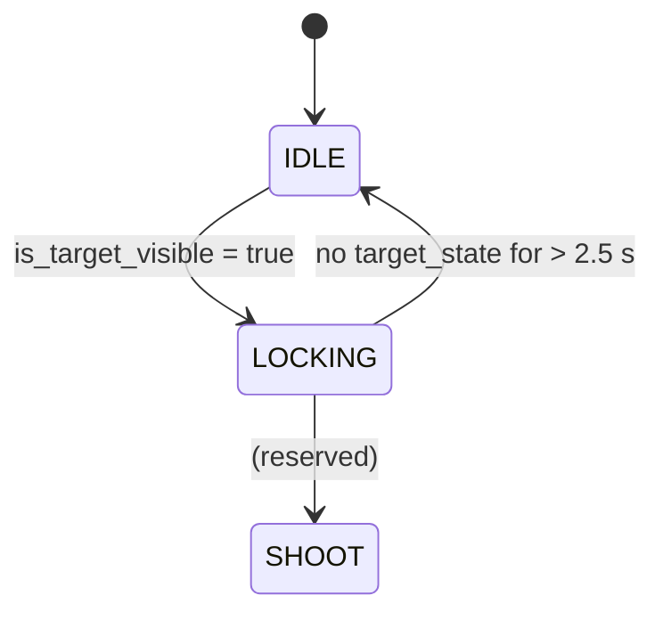
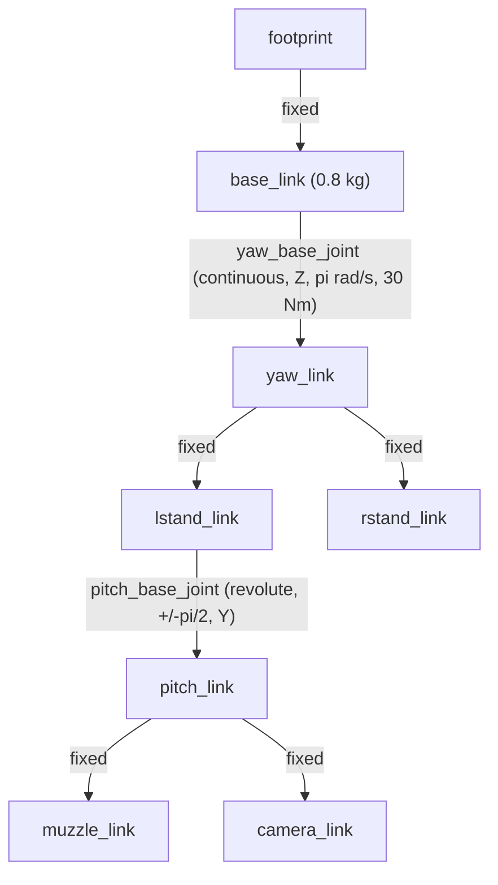

<div align="center">

# Skywarden

**Autonomous Counter-UAS Fire Control System**

*Real-time drone detection, tracking, and predictive targeting in ROS 2*

[](https://youtu.be/-JinIK--sEw)


</div>

---

## Overview

Skywarden is a full-stack autonomous turret that detects, tracks, and predicts the trajectory of hostile drones using a single monocular camera. Built on ROS 2 Jazzy with Gazebo simulation, it implements a complete **perception → estimation → control** pipeline — the same loop a real counter-UAS fire-control system runs.

**Highlights**

- **Perception:** YOLO26n detection, exported to **OpenVINO INT8** for CPU-only inference
- **Tracking:** BotSORT multi-object tracking with Kalman-filter velocity estimation
- **Estimation:** Depth, predictive lead, and muzzle-parallax correction from 2D boxes alone
- **Control:** Dual-axis PID with anti-windup, plus a fail-safe finite state machine
- **Simulation:** Full Gazebo Harmonic world with adversarial drone models and `ros2_control`

---

## System Architecture

```
┌──────────────────────────────────────────────────────────────────────┐
│                          PERCEPTION LAYER                            │
├──────────────────────────────────────────────────────────────────────┤
│  Gazebo Camera ──► DetectorNode ──► YOLO26n (INT8) ──► BotSORT       │
│                          │                                           │
│                          ▼                                           │
│              ┌───────────────────────┐                               │
│              │  Target State Est.    │  • Depth (pinhole model)      │
│              │                       │  • Predictive lead            │
│              │                       │  • Muzzle parallax            │
│              └──────────┬────────────┘                               │
└─────────────────────────┼────────────────────────────────────────────┘
                          │ /target_state
                          ▼
┌──────────────────────────────────────────────────────────────────────┐
│                           CONTROL LAYER                              │
├──────────────────────────────────────────────────────────────────────┤
│  ControllerNode @ 10 Hz                                              │
│  ┌──────────┐    ┌──────────────┐    ┌────────────────────────────┐  │
│  │   FSM    │───►│ PID yaw      │───►│  ros2_control              │  │
│  │ IDLE/LOCK│    │ PID pitch    │    │  joint_trajectory_ctrl     │  │
│  └──────────┘    └──────────────┘    └────────────────────────────┘  │
└──────────────────────────────────────────────────────────────────────┘
                          │
                          ▼
┌──────────────────────────────────────────────────────────────────────┐
│                       VISUALIZATION LAYER                            │
├──────────────────────────────────────────────────────────────────────┤
│  TrajectoryPredictorNode ──► ballistic arc marker (RViz, 30 Hz)     │
│  Annotated camera feed with boxes + HUD overlay                      │
└──────────────────────────────────────────────────────────────────────┘
```

---

## Key Technical Features

### Target Locking
Commits to the detection closest to boresight (minimum squared Euclidean distance from image center) and maintains lock via BotSORT track ID through occlusions and detection noise — no target switching mid-engagement.

### State Estimation from Monocular Vision
Three corrections turn a 2D bounding box into an aimable target:

| Correction | Formula | Purpose |
|:-----------|:--------|:--------|
| Depth | `depth = (W · Fx) / w_px` | Pinhole model, known drone width (0.33 m) |
| Lead | `cx_pred = cx + Vx · t_hit` | Aim where the drone *will be* at impact |
| Parallax | `cy_corr = cy + (offset / depth) · Fy` | Compensate camera–muzzle vertical offset (0.06 m) |

BotSORT's Kalman state (`track.mean[4:6]`) is reused directly as the velocity source — the tracker is part of the estimator, not just an ID assigner.

### PID Control with Anti-Windup

```python
P  = Kp * e
Sigma = clamp(Sigma * 0.98 + e * dt, -2.5, +2.5)   # leaky accumulator + hard cap
I  = Ki * Sigma
D  = Kd * (e - e_prev) / dt
cmd = P + I + D
```

Gains: **Kp = 0.7, Ki = 0.5, Kd = 0.05.** Integral decay (0.98) prevents stale error from pushing the turret off-target; the ±2.5 cap bounds integrator contribution.

### Fail-Safe State Machine



On timeout, zero-velocity commands are published so the turret **halts instead of drifting**.

<details>
<summary><b>Ballistic trajectory prediction</b></summary>

`TrajectoryPredictorNode` renders the projectile's predicted path as an RViz `LINE_STRIP` marker at 30 Hz. It looks up the `footprint -> muzzle_link` TF, rotates the muzzle quaternion into a forward vector, and integrates:

```
x(t) = x0 + vx*t
y(t) = y0 + vy*t
z(t) = z0 + vz*t - 0.5*g*t^2
```
</details>

<details>
<summary><b>Model & training pipeline</b></summary>

| Aspect | Detail |
|:-------|:-------|
| Architecture | Ultralytics **YOLO26n**, single class (`drone`), 640x640, end-to-end head (NMS-free) |
| Dataset | `Drone-1` (custom training, Kaggle) |
| Export | **OpenVINO IR INT8** — `FakeQuantize`-annotated `.xml` + `.bin` |
| Inference | CPU-friendly, no GPU required |
| Tracking | BotSORT via `model.track(persist=True)` |
| Benchmark | `builder_utility/yolo_benchmark.py` — predict vs. track latency, FPS, RSS |
</details>

---

## ROS 2 Interface Map

| Topic | Type | Producer → Consumer |
|:------|:-----|:--------------------|
| `/camera/image/compressed` | `sensor_msgs/CompressedImage` | Gazebo → `DetectorNode` |
| `/camera/annotated/compressed` | `sensor_msgs/CompressedImage` | `DetectorNode` → HUD |
| `/target_state` | `skywarden_interfaces/TargetState` | `DetectorNode` → `ControllerNode` |
| `/joint_trajectory_controller/commands` | `std_msgs/Float64MultiArray` | `ControllerNode` → `ros2_control` |
| `/targeting_trajectory` | `visualization_msgs/Marker` | `TrajectoryPredictorNode` → RViz |

<details>
<summary><b>Custom message — <code>TargetState.msg</code></b></summary>

```msg
bool    is_target_visible
float32 norm_err_x
float32 norm_err_y
float32 depth_meters
```
</details>

---

## Mechanical Model

The turret is fully parameterized in Xacro, with per-link inertia tensors computed via a `box_inertial` macro.



`ros2_control` with `joint_trajectory_controller` + `joint_state_broadcaster` exposes both actuated joints. Joint limits (30 N·m, π rad/s) mimic NEMA-17-class hardware, so gains tuned in sim transfer realistically to physical hardware.

---

## Packages

| Package | Role |
|:--------|:-----|
| `skywarden_ai` | `DetectorNode` (YOLO + BotSORT + estimation), `TrajectoryPredictorNode`, HUD overlay, INT8 OpenVINO model |
| `skywarden_controller` | `ControllerNode` — yaw/pitch PID loops, anti-windup, FSM |
| `skywarden_description` | Xacro URDF: kinematic tree, inertia macros, Gazebo plugins, `ros2_control` |
| `skywarden_bringup` | `gz.launch.py` full-sim bringup, `display.launch.py`, RViz configs |
| `skywarden_interfaces` | `TargetState.msg` |
| `threat_drone_sim` | Adversarial drone SDF models + movement nodes |
| `builder_utility` | `yolo_benchmark.py` — latency & memory benchmarking harness |

---

## Getting Started

**Prerequisites**

- Ubuntu 24.04 (Noble Numbat)
- [ROS 2 Jazzy Desktop](https://docs.ros.org/en/jazzy/Installation.html)
- Gazebo Harmonic + ROS bridge:

```bash
sudo apt install ros-jazzy-ros-gz-sim ros-jazzy-ros-gz-bridge ros-jazzy-ros-gz-image
```

Python deps (Ultralytics, OpenVINO, OpenCV) are declared per package in `package.xml` / `setup.py`.

**Build**

```bash
mkdir -p ~/skywarden_ws/src && cd ~/skywarden_ws/src
git clone https://github.com/zeyad-shaban/skywarden.git .
cd ~/skywarden_ws
rosdep install --from-paths src --ignore-src -r -y
colcon build --symlink-install --cmake-args -DCMAKE_BUILD_TYPE=Release
source install/setup.bash
```

**Run**

```bash
# Full simulation — Gazebo world, threat drone, bridge, controllers, detection
ros2 launch skywarden_bringup gz.launch.py

# Kinematic inspection in RViz (no physics)
ros2 launch skywarden_bringup display.launch.py
```

---

## Tech Stack

| Layer | Technologies |
|:------|:-------------|
| Framework | ROS 2 Jazzy, `ros2_control`, tf2, custom interfaces |
| Simulation | Gazebo Harmonic, `ros_gz` bridging |
| Perception | Ultralytics YOLO26n → OpenVINO INT8, BotSORT |
| Control | Python PID loops, finite state machine |
| Modeling | URDF / Xacro with computed inertials |
| Build | colcon, ament_cmake |

---

## Author

**Zeyad Shaban** — [GitHub](https://github.com/zeyad-shaban)

<div align="center">

*An end-to-end demonstration of autonomous systems engineering: perception, estimation, and control in a unified ROS 2 architecture.*

</div>
